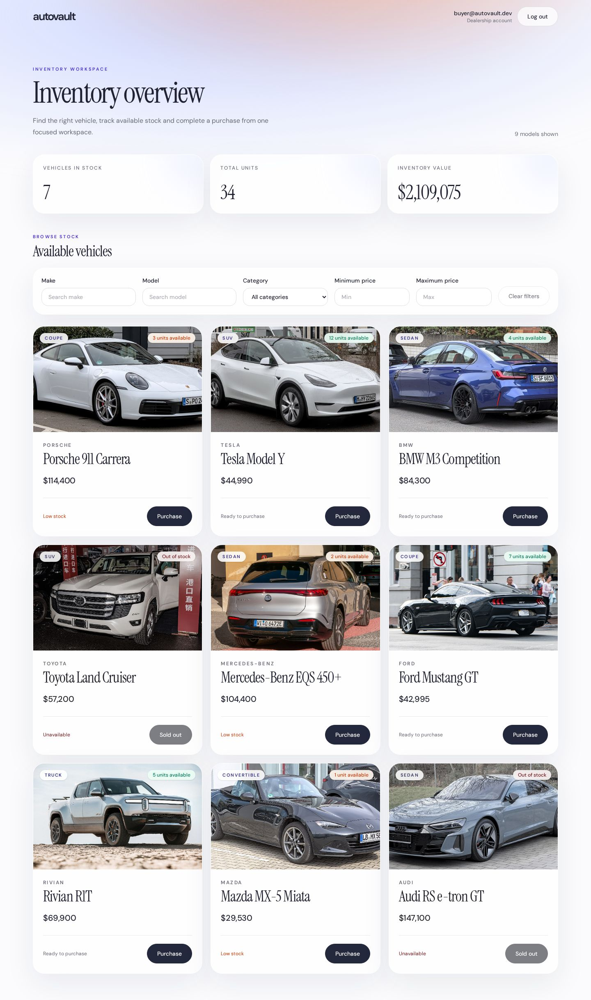
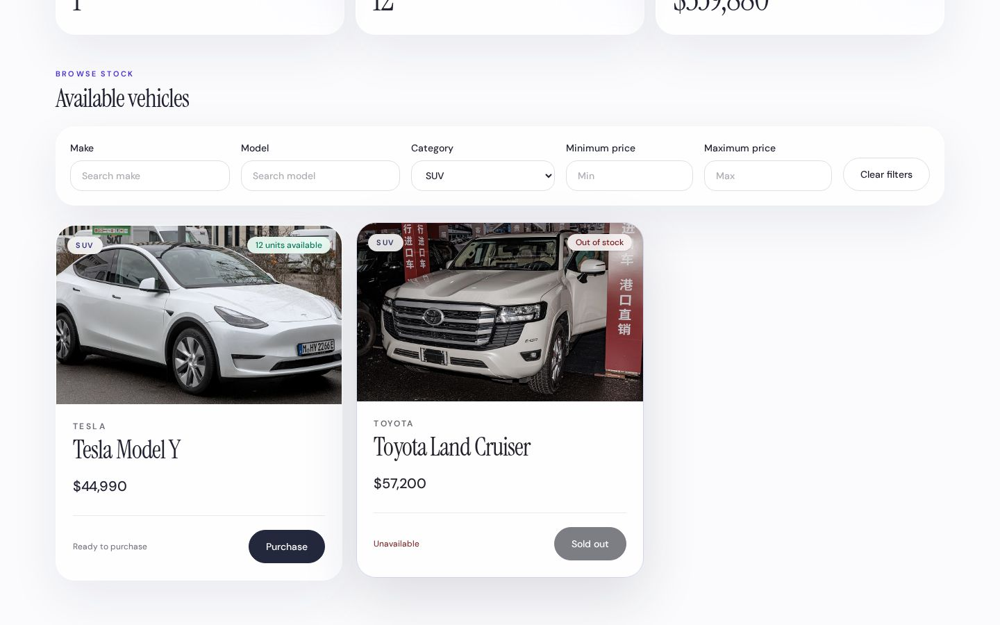
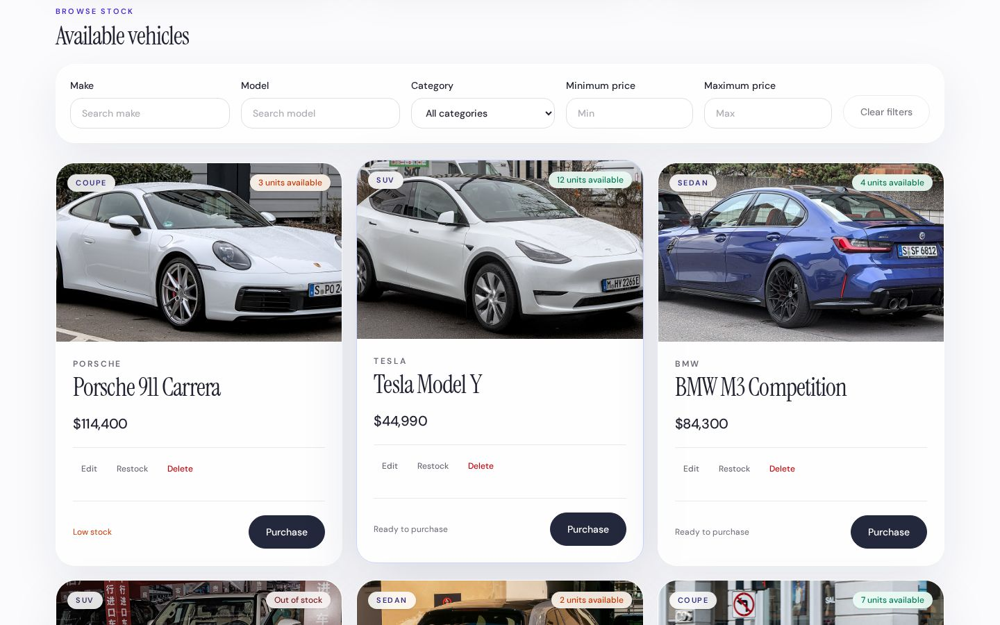
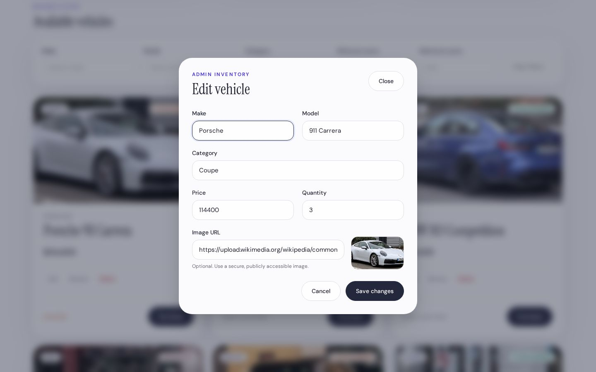
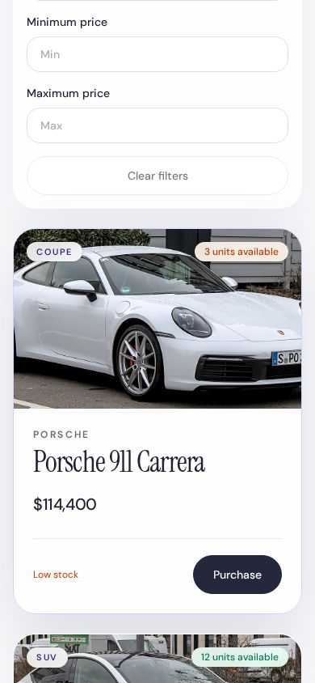
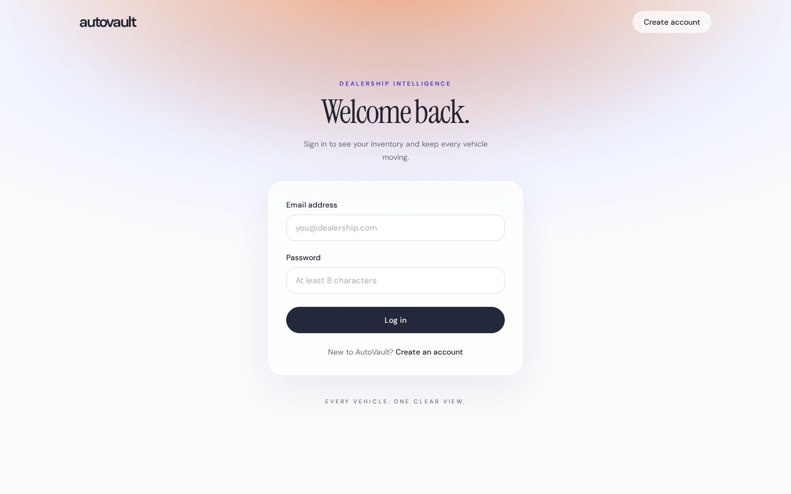

# AutoVault

AutoVault is a car dealership inventory system with an Express, TypeScript, Drizzle, and PostgreSQL API secured by JWT authentication and roles, plus a React, Vite, and Tailwind SPA. It was built test-first.

## Screenshots

<table>
  <tr>
    <td><br>Dashboard</td>
    <td><br>Search</td>
  </tr>
  <tr>
    <td><br>Admin controls</td>
    <td><br>Edit with photo URL</td>
  </tr>
  <tr>
    <td><br>Mobile</td>
    <td><br>Login</td>
  </tr>
</table>

## Features

- Registration and login with JWT authentication and user or admin roles
- Inventory summaries, vehicle browsing, and filters for make, model, category, and price
- Stock purchases with insufficient-stock protection
- Admin controls to add, edit, restock, and delete vehicles, including photo URLs
- Responsive SPA with persistent PostgreSQL or embedded PGlite storage

## Running locally

Node.js 22 is the only prerequisite. The backend uses embedded PGlite when `DATABASE_URL` is unset.

Start the backend on port 3000:

```sh
cd backend
npm ci
cp .env.example .env
# Set JWT_SECRET in .env to a secret with at least 32 characters.
npm run seed
npm run dev
```

In another terminal, start the frontend on port 5173. Vite proxies `/api` to the backend.

```sh
cd frontend
npm ci
npm run dev
```

The seed values in `.env.example` create these demo logins:

| Role | Email | Password |
| --- | --- | --- |
| Admin | `admin@example.com` | `replace-with-a-secure-admin-password` |
| User | `demo@example.com` | `demo-password` |

## Tests

Run the test suite and coverage in each package:

```sh
cd backend
npm test
npm run test:coverage
cd ../frontend
npm test
npm run test:coverage
```

## API

| Method | Endpoint | Access |
| --- | --- | --- |
| `GET` | `/api/health` | public |
| `POST` | `/api/auth/register` | public |
| `POST` | `/api/auth/login` | public |
| `GET` | `/api/vehicles` | user |
| `GET` | `/api/vehicles/search` | user |
| `GET` | `/api/vehicles/:id` | user |
| `POST` | `/api/vehicles/:id/purchase` | user |
| `POST` | `/api/vehicles` | admin |
| `PUT` | `/api/vehicles/:id` | admin |
| `POST` | `/api/vehicles/:id/restock` | admin |
| `DELETE` | `/api/vehicles/:id` | admin |

`user` means any authenticated user, including an admin.

## Deployment

Import the repository root as one Vercel project. The root `vercel.json` builds the Express backend and Vite frontend as separate services in one deployment, routes `/api/*` to the backend, and sends all other paths to the frontend with an SPA fallback.

Add Neon through the Vercel Storage integration. The integration creates the database and sets `DATABASE_URL`. Set these additional project environment variables:

- `JWT_SECRET`: secret with at least 32 characters
- `CORS_ORIGIN`: deployed frontend URL
- `ADMIN_EMAIL` and `ADMIN_PASSWORD`: seeded admin credentials
- `DEMO_USER_EMAIL` and `DEMO_USER_PASSWORD`: seeded user credentials

The backend build runs database migrations. After the first deployment, copy the production environment values into `backend/.env` and run `npm run seed` once from `backend` to create the demo accounts and inventory.

## Photo credits

Vehicle photos are from Wikimedia Commons under CC BY / CC BY-SA licenses.

[Porsche 911 Carrera, CC BY-SA 4.0](https://commons.wikimedia.org/wiki/File:Porsche_992_Carrera_S_coupe_IMG_5832.jpg) · [Tesla Model Y, CC BY-SA 4.0](https://commons.wikimedia.org/wiki/File:Tesla_Model_Y_1X7A6211.jpg) · [BMW M3 Competition, CC BY-SA 4.0](<https://commons.wikimedia.org/wiki/File:BMW_M3_Competition_(G80)_1X7A0170.jpg>) · [Toyota Land Cruiser, CC BY-SA 4.0](<https://commons.wikimedia.org/wiki/File:TOYOTA_LAND_CRUISER_(J300)_China.jpg>) · [Mercedes-Benz EQS, CC BY-SA 4.0](<https://commons.wikimedia.org/wiki/File:Mercedes-Benz_EQS_450%2B,_IAA_Open_Space_2023,_Munich_(P1120197).jpg>) · [Ford Mustang GT, CC BY 4.0](<https://commons.wikimedia.org/wiki/File:Ford_Mustang_GT_(S650)_Washington_DC_Metro_Area,_USA.jpg>) · [Rivian R1T, CC BY-SA 4.0](https://commons.wikimedia.org/wiki/File:Rivian-r1t-2021.jpg) · [Mazda MX-5 Miata, CC BY-SA 4.0](<https://commons.wikimedia.org/wiki/File:Mazda_MX-5_(ND)_1X7A2479.jpg>) · [Audi RS e-tron GT, CC BY-SA 4.0](https://commons.wikimedia.org/wiki/File:Audi_RS_e-tron_GT_1X7A1874.jpg)
